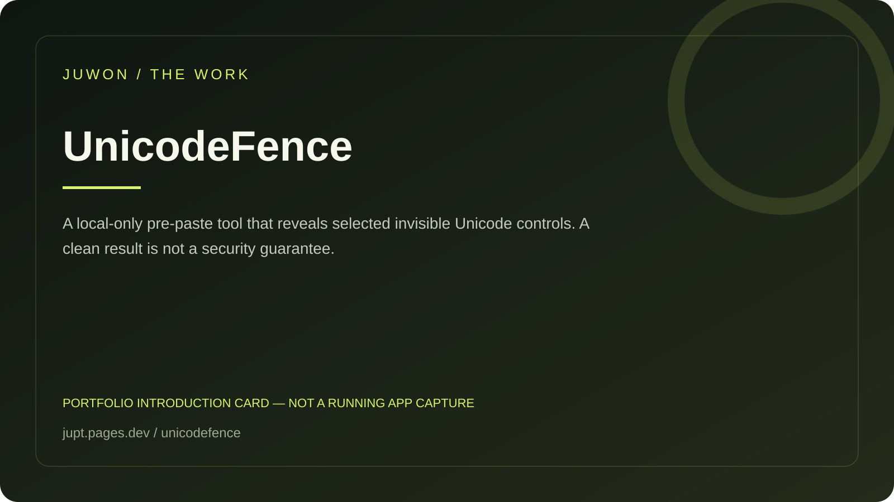

<!-- JUWON-PORTFOLIO-INTRO:START -->
# UnicodeFence



*Portfolio introduction card, not a screenshot of a running application.*

*포트폴리오 소개 카드입니다. 실행 화면 캡처가 아닙니다.*

## English

A local-only pre-paste tool that reveals selected invisible Unicode controls. A clean result is not a security guarantee.

[View JUWON's portfolio](https://jupt.pages.dev/) · [Browse the project collection](https://jupt.pages.dev/projects)

**Scope:** This README presents the repository's documented intent and recorded visual evidence. It does not certify that every feature is complete, deployed, or currently working. Follow the original setup, safety, and license documentation below.

## 한국어

AI에 붙여넣기 전 보이지 않는 유니코드 제어문자를 확인하는 도구.

[JUWON 포트폴리오 보기](https://jupt.pages.dev/) · [전체 프로젝트 보기](https://jupt.pages.dev/projects)

**확인 범위:** 저장소의 문서상 목적과 기록된 화면 근거를 소개합니다. 모든 기능의 완성·배포·현재 정상 작동을 보증하지 않습니다. 설치법·안전 주의사항·라이선스는 아래 기존 문서를 확인하세요.
<!-- JUWON-PORTFOLIO-INTRO:END -->

---

## Original documentation / 기존 문서

# UnicodeFence 🛡️

## See what your eyes can’t

AI assistants read characters people cannot see. **UnicodeFence is a tiny,
local-only pre-paste check that reveals selected invisible Unicode controls in a
text file before an AI chat or coding agent receives it.**

```text
human sees:  “review this note”
AI receives: “review this note” + hidden control characters
UnicodeFence: exact code point • line • column • visible context
```

It is deliberately boring in the best way: no account, no model, no upload,
no clipboard interception, no automatic rewrite.

## Quick start

```powershell
python -m pip install unicodefence
unicodefence scan .\copied-note.txt
unicodefence scan .\copied-note.txt --format json
```

Exit codes are script-friendly:

- `0` — no selected controls found (`CLEAN`)
- `1` — review recommended (`REVIEW`)
- `2` — the file could not be safely scanned (`ERROR`)

Try the checked-in demonstration file:

```powershell
unicodefence scan .\examples\hidden-marker.txt
```

## What it reports

The default rule set reports high-signal controls that can be invisible in
ordinary editors:

- zero-width space/non-joiner, word joiner, and byte-order mark;
- bidirectional embeddings, overrides, and isolates;
- Unicode tag characters.

The default deliberately does **not** flag zero-width joiners or variation
selectors commonly used by emoji and scripts. A `CLEAN` result is not a
security guarantee: it only means this narrow rule set found nothing.

## Why this exists

Prompt injection becomes harder to review when data and instructions arrive in
the same text channel. OWASP calls out Unicode smuggling with invisible
characters as one prompt-injection pattern. UnicodeFence turns that “I can’t
see it” moment into evidence a person can review before pasting.

Research notes and source links: [`docs/research/2026-09-25-founder-note.md`](docs/research/2026-09-25-founder-note.md).

## Safety boundary

UnicodeFence reads only the explicitly selected file. It does not walk a
directory, follow symbolic links, execute content, call a model, make network
requests, persist input, or modify the file. JSON context can contain sensitive
text; redirect it only to a location you trust.

## Development

```powershell
python -m pip install -e ".[dev]"
python -m pytest -q
ruff check .
mypy
python -m build
python -m pip_audit
```

The implementation design is in
[`docs/superpowers/specs/2026-09-25-unicodefence-design.md`](docs/superpowers/specs/2026-09-25-unicodefence-design.md).

## Contributing and security

See [`CONTRIBUTING.md`](CONTRIBUTING.md) and [`SECURITY.md`](SECURITY.md).
Please include a regression fixture for every new Unicode rule, including a
false-positive fixture when the character is legitimate in common text.

## License

MIT — see [`LICENSE`](LICENSE).
